# 谢翌事件中文评论存档

2026-11-25

> **编者注**　本篇收录谢翌 2026 年 11 月 19 日被 ICE 拘留以后，中文网络上的公开评论，平台有 X、知乎和文学城。按立场分三组，每组再按平台分海外和国内，X 与文学城算海外，知乎算国内。组内按截图时的浏览量或赞同数从高到低排列，数据截至 2026 年 11 月 25 日。外文帖截的是 X 自带的中文译文。

## 中文网络就谢翌事件态度观察

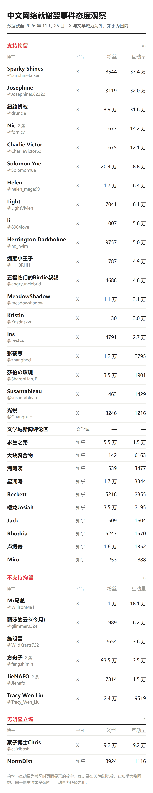

## 支持拘留或指责她家行骗

### 海外

#### Sparky Shines @sunshinetalker

X · 11 月 22 日 · 粉丝 8544 · 浏览 37.4 万 · [原帖](https://x.com/sunshinetalker/status/2124724168872591785)

说她一家是跑路的 P2P 诈骗家庭，拿美国纳税人的钱吃米其林，嘲讽她男友要当冤大头。

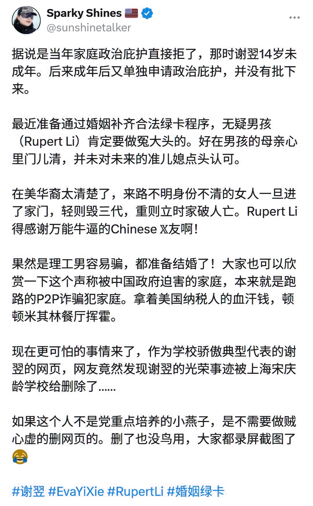

#### Josephine @Josephine082322

X · 11 月 22 日 · 粉丝 3119 · 浏览 32.0 万 · [原帖](https://x.com/Josephine082322/status/2124727074472812564)

说谢家是 2016 年 P2P 暴雷时卷款跑路来美国申请庇护的。

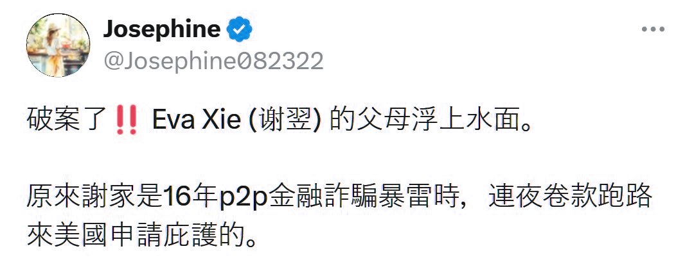

#### 纽约博叔 @druncle

X · 11 月 22 日 · 粉丝 3.9 万 · 浏览 31.6 万 · [原帖](https://x.com/druncle/status/2124625710010540231)

说她在上海读过学费很高的学校，却以受迫害为由申请庇护，问这种人不被驱逐是不是天理难容。

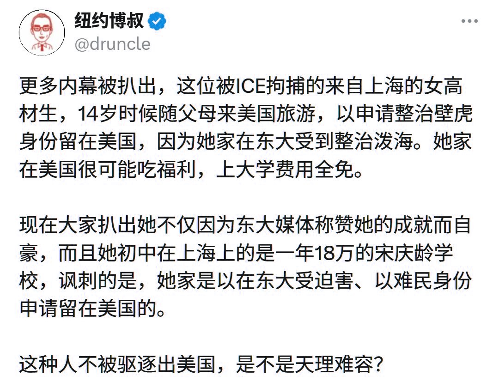

#### Nic @fornicv

X · 粉丝 677 · 两帖浏览合计 14.2 万 · [11 月 24 日原帖](https://x.com/fornicv/status/2125464911644086323) · [11 月 25 日原帖](https://x.com/fornicv/status/2125505558082093554)

11 月 24 日一帖点名她母亲让外婆当借款担保人，说谢家坑了很多亲戚，称之为「诈骗之家」。

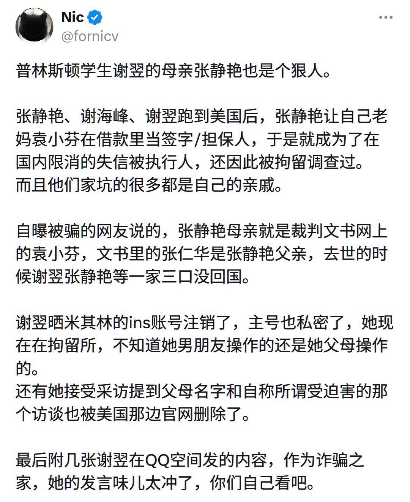

11 月 25 日一帖说她花家里的钱时理所当然，家里缺钱时就要逃离原生家庭。

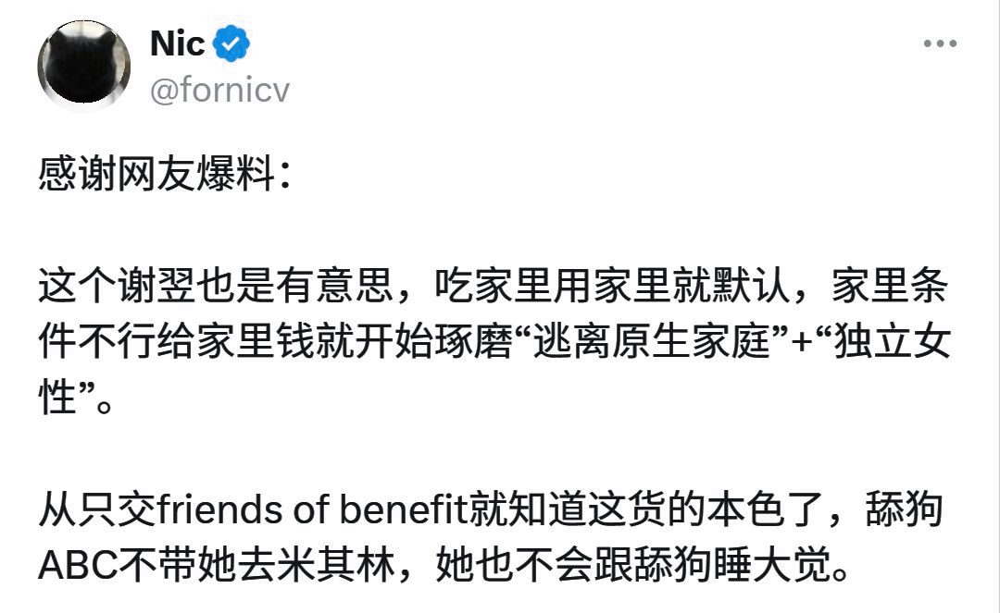

#### Charlie Victor @CharlieVictor62

X · 11 月 23 日 · 粉丝 675 · 浏览 12.1 万 · [原帖](https://x.com/CharlieVictor62/status/2125012125387211125)

说本来关几天就能出来，是导师和同学的舆论施压引来网友举报，预言她会被遣返。

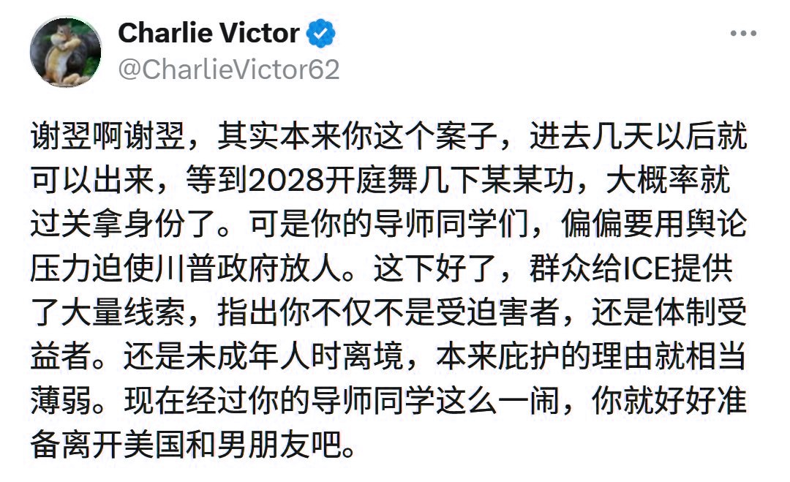

#### Solomon Yue @SolomonYue

X · 11 月 22 日 · 粉丝 20.4 万 · 浏览 8.8 万 · [原帖](https://x.com/SolomonYue/status/2124723801414041774)

引中国法院把她父母列为失信被执行人的裁定，说他们不是受迫害而是骗子，庇护应被驳回，一家三口都应驱逐。原帖是英文，截图是 X 自带的中文译文。

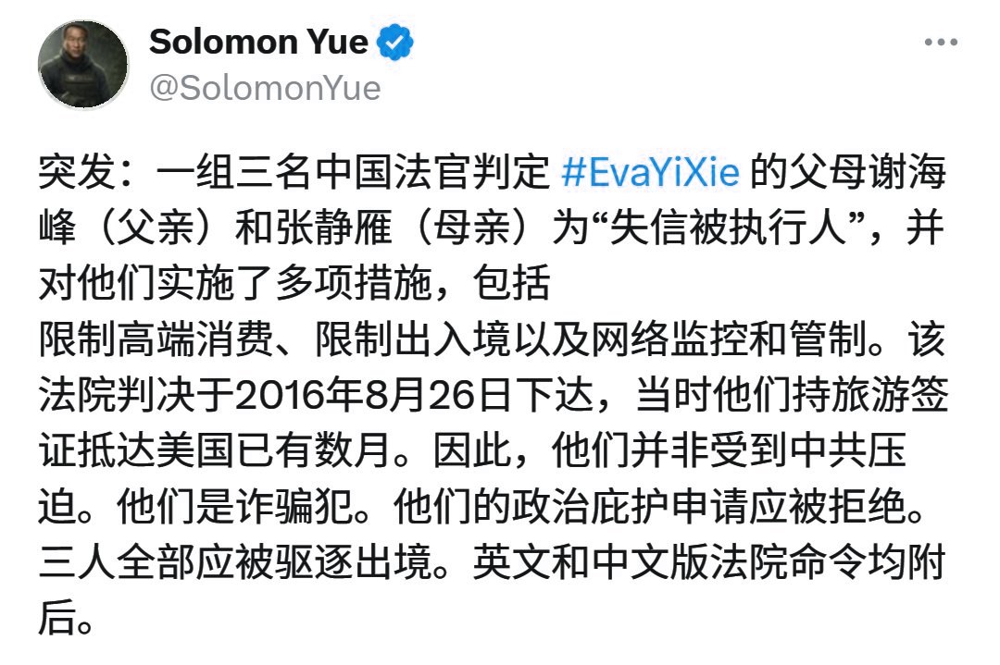

#### Helen @helen_maga99

X · 11 月 22 日 · 粉丝 1.7 万 · 浏览 6.4 万 · [原帖](https://x.com/helen_maga99/status/2124602187448005070)

说自己起初同情她，看了她晒出的侨报表彰报道后起疑，怀疑她是被定向培养的人才。

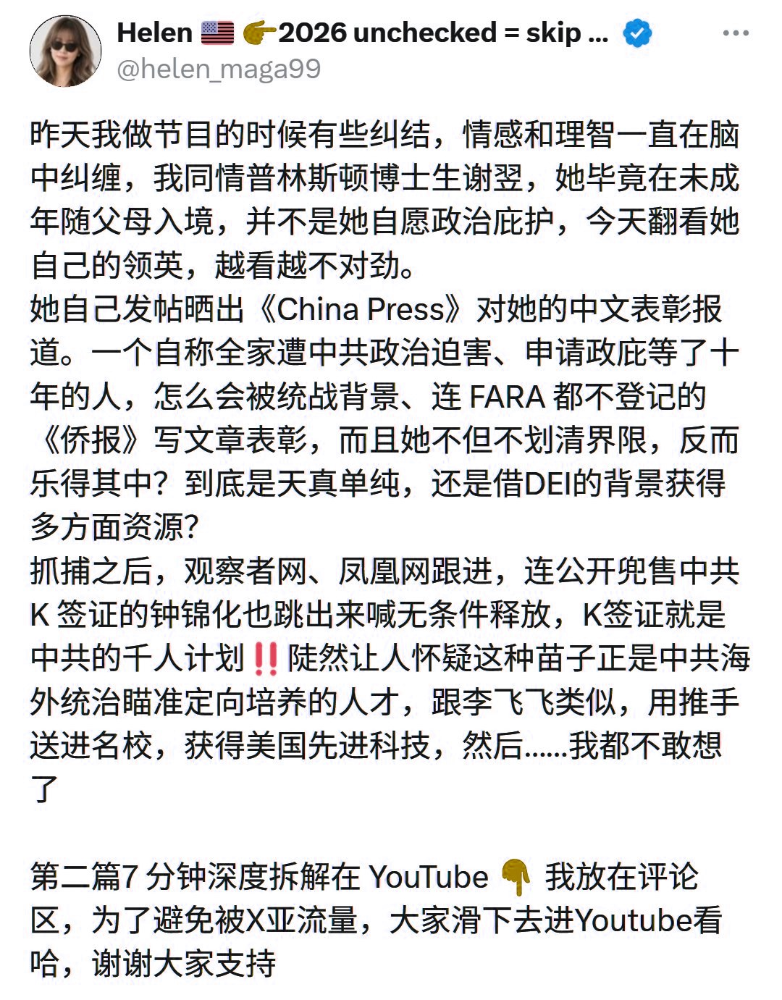

#### Light @LightVivien

X · 11 月 24 日 · 粉丝 7041 · 浏览 6.1 万 · [原帖](https://x.com/LightVivien/status/2125394404970271131)

转述一则「谢家人爱党爱国」的声明，反问既然没受过迫害，为什么申请庇护。

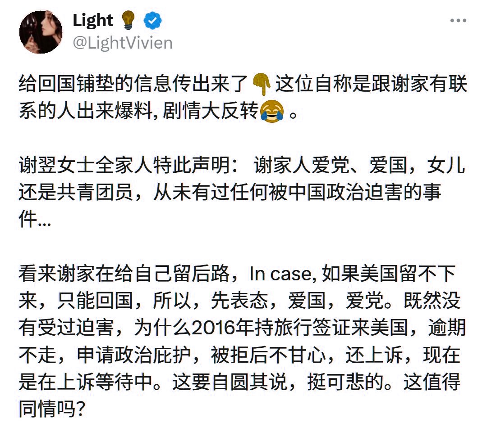

#### li @8964love

X · 11 月 24 日 · 粉丝 1007 · 浏览 5.6 万 · [原帖](https://x.com/8964love/status/2125215431887925441)

依据裁判文书梳理谢家的借款，估计总额上千万元，反驳同情她的人。

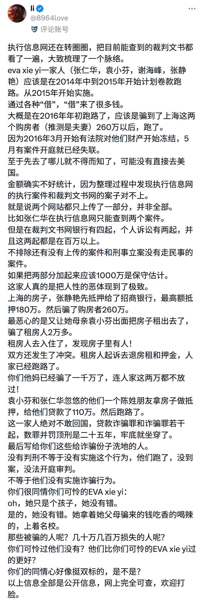

#### Herrington Darkholme @hd_nvim

X · 11 月 24 日 · 粉丝 9757 · 浏览 5.0 万 · [原帖](https://x.com/hd_nvim/status/2125402578045522144)

一串五条。前几条用替谢家辩护的口吻讲这家人的经历，第四条末尾作者说明这是让 ChatGPT 编的故事，第五条把同一个故事改写成煽情版本。整串是在讽刺替谢家开脱的说法。

#### 煽颠小王子 @HHQRHH

X · 11 月 24 日 · 粉丝 787 · 浏览 4.9 万 · [原帖](https://x.com/HHQRHH/status/2125222641342816407)

讥讽她用名牌包、坐头等舱，却拿全额贫困补助。

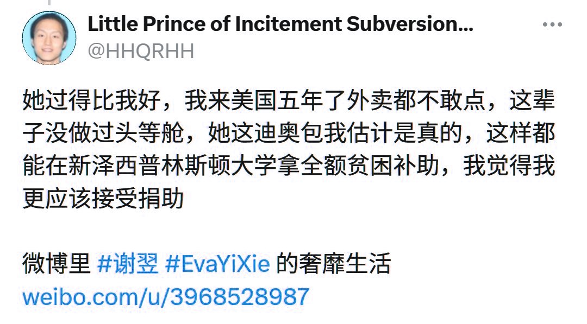

#### 五福临门的Birdie叔叔 @angryunclebrid

X · 11 月 25 日 · 粉丝 4688 · 浏览 4.6 万 · [原帖](https://x.com/angryunclebrid/status/2125508074941415685)

说她父母是「江湖游骗」，她本人可能到大学毕业都不知情。

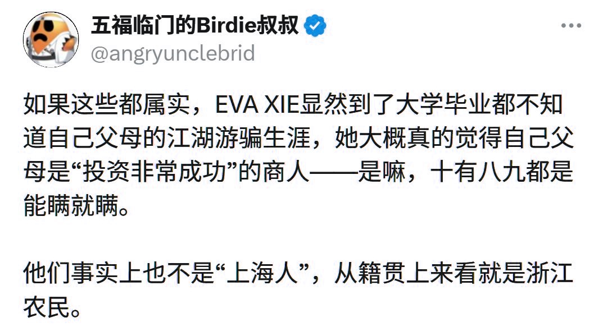

#### MeadowShadow @meadowshadow

X · 11 月 23 日 · 粉丝 1.1 万 · 浏览 3.1 万 · [原帖](https://x.com/meadowshadow/status/2125027927909654981)

说普通中国人反对的是谢家借庇护和教育机会钻制度的空子。原帖是英文，截图是 X 自带的中文译文。

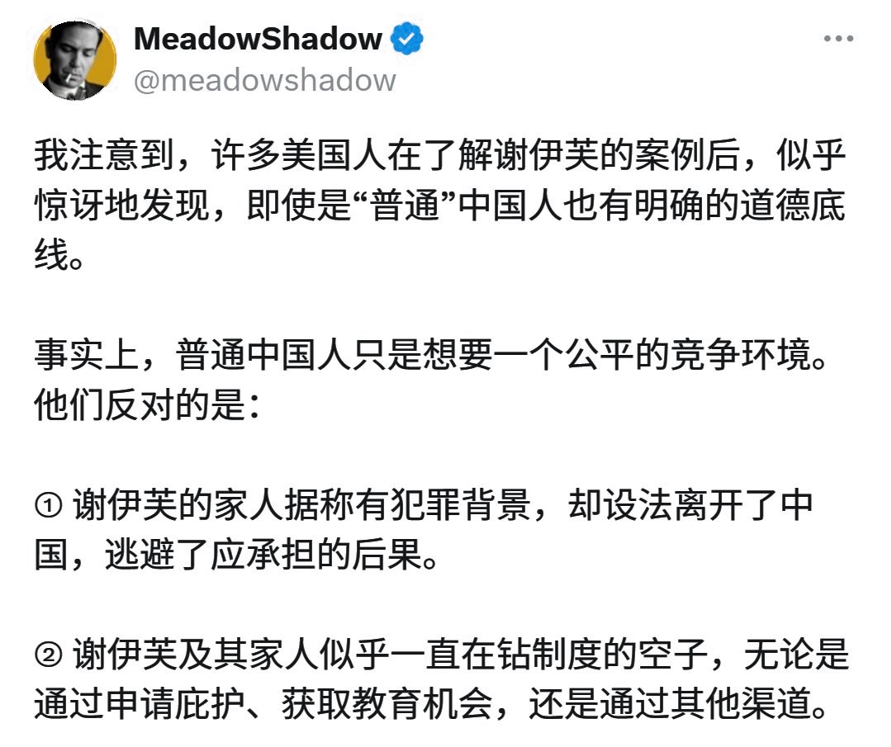

#### Kristin @Kristinskvt

X · 11 月 23 日 · 粉丝 30 · 浏览 3.0 万 · [原帖](https://x.com/Kristinskvt/status/2124803348515946636)

自称受害者亲属，说她父亲在宁波骗了很多亲戚的钱。

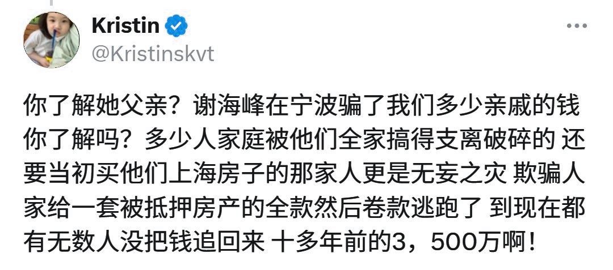

#### Ins @Ins4x4

X · 11 月 23 日 · 粉丝 4791 · 浏览 2.7 万 · [原帖](https://x.com/Ins4x4/status/2124777716486738130)

说她以贫困生资格进麻省理工属于欺诈，号召网友举报。

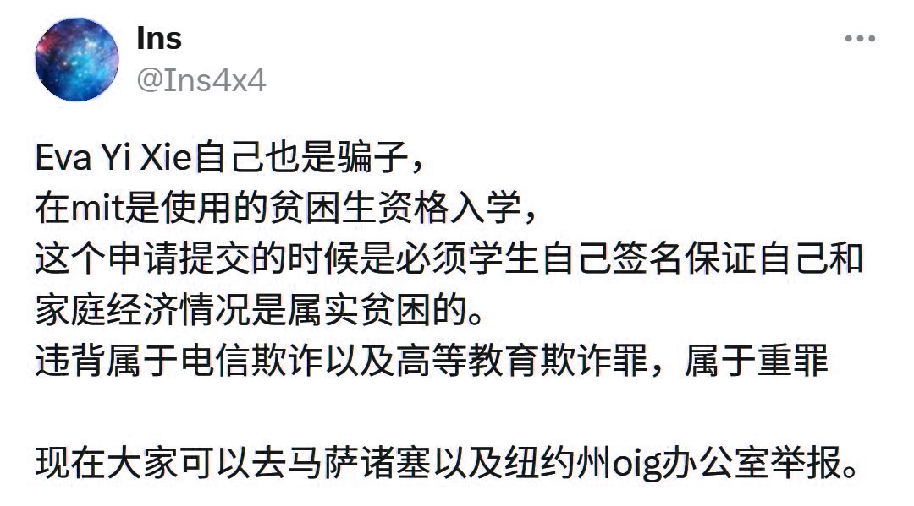

#### 张鹤慈 @zhangheci

X · 11 月 23 日 · 粉丝 1.2 万 · 浏览 2795 · [原帖](https://x.com/zhangheci/status/2124985798596661461)

说她父母是老赖，申请庇护时不可能如实交代，她申请学校时的信息也可能不真实。

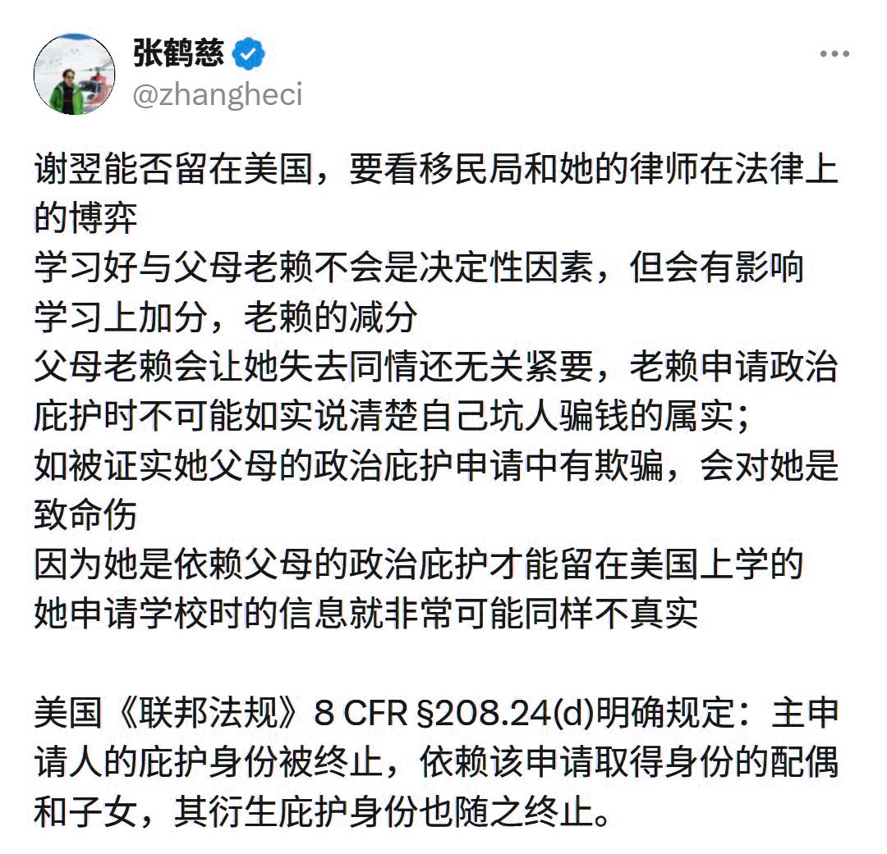

#### 莎伦の玫瑰 @SharonHanJP

X · 11 月 23 日 · 粉丝 3.5 万 · 浏览 1901 · [原帖](https://x.com/SharonHanJP/status/2124810488785908143)

说她父母是金融诈骗犯，带着骗来的钱到美国继续骗。

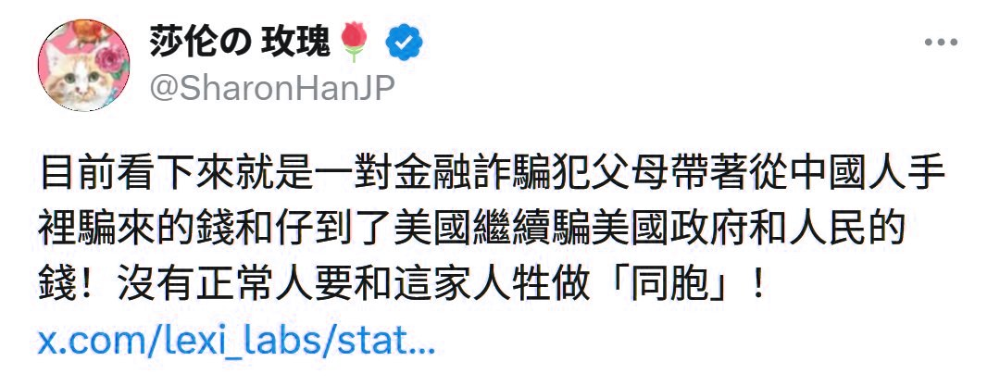

#### Susantableau @susantableau

X · 11 月 23 日 · 粉丝 463 · 浏览 1429 · [原帖](https://x.com/susantableau/status/2124896390987796499)

对声援她的人说，她父母靠 P2P 卷钱跑路来美国骗身份，她在美国装穷进名校。

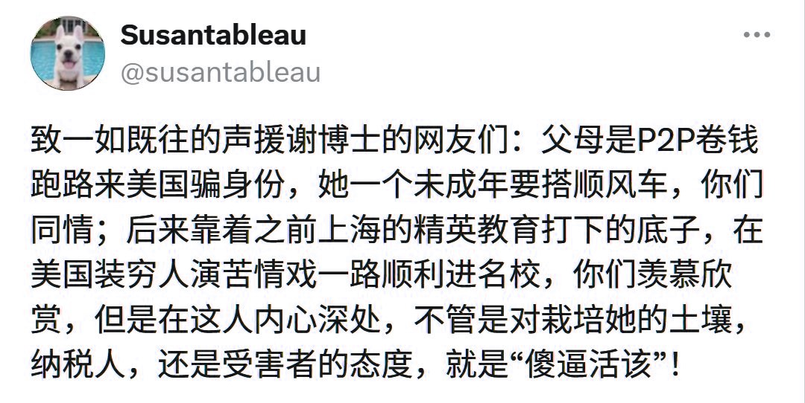

#### 光锐 @GuangruiH

X · 11 月 25 日 · 粉丝 3246 · 浏览 1216 · [原帖](https://x.com/GuangruiH/status/2125479436598518082)

一串三条，以「爹娘卷了几千万跑路」为前提，追问钱的去向，讥讽她靠结婚留美。

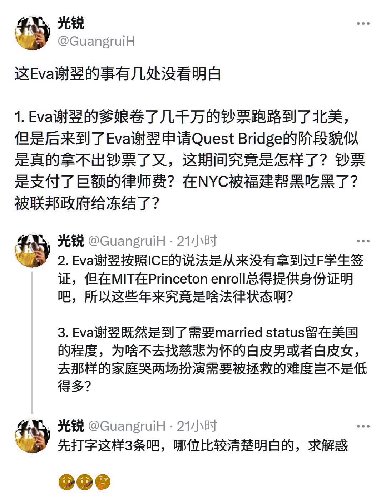

#### 文学城新闻评论区

文学城 · 11 月 24 日 · [评论页](https://www.wenxuecity.com/news/index.php?act=comment&postid=126845480&channel=news)

新闻《普林斯顿博士被ICE拘留 庇护10年仍被指非法移民》下最新的 10 条读者评论，全部指责谢家诈骗或主张遣返。

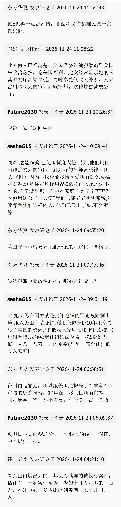

### 国内

以下均为知乎问题「如何评价持待审庇护申请的普林斯顿大学博士生谢翌遭美国 ICE 拘留」下的回答。

#### 求生之路

知乎 · 11 月 22 日 · 粉丝 5.5 万 · 赞同 14883 · [原回答](https://www.zhihu.com/question/2107456808227034921/answer/2107871945689776299)

「给不清楚真相的群众说明一下」，说谢家是有钱人借庇护滞留美国，ICE 没有做错。

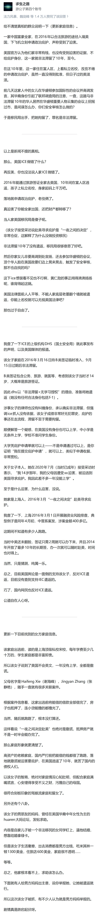

#### 大块聚合物

知乎 · 11 月 22 日 · 粉丝 142 · 赞同 6163 · [原回答](https://www.zhihu.com/question/2107456808227034921/answer/2108018748443604091)

断定谢家是 P2P 爆雷卷钱跑路，说 ICE「办了件大好事」。

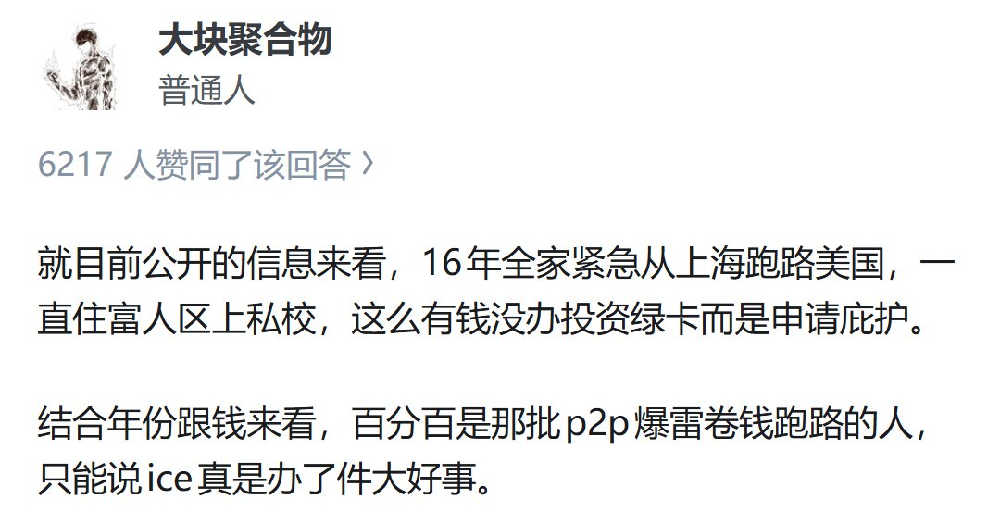

#### 海阿姨

知乎 · 11 月 22 日 · 粉丝 539 · 赞同 3477 · [原回答](https://www.zhihu.com/question/2107456808227034921/answer/2107937485762384921)

说无论从中国还是美国的立场看，ICE 都做对了。

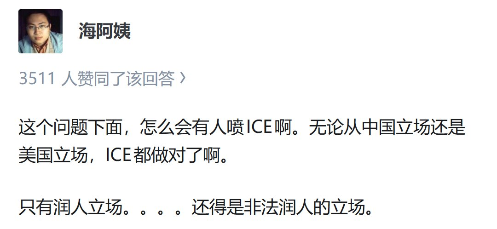

#### 星澜海

知乎 · 11 月 22 日 · 粉丝 1.7 万 · 赞同 3344 · [原回答](https://www.zhihu.com/question/2107456808227034921/answer/2107836992889284312)

「她被遣返，有什么问题？」讲唐人街律所摆拍受迫害材料的见闻，把庇护申请说成普遍造假。

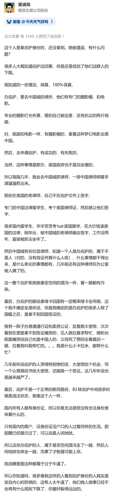

#### Beckett

知乎 · 11 月 24 日 · 粉丝 5218 · 赞同 2855 · [原回答](https://www.zhihu.com/question/2107456808227034921/answer/2108712685017763925)

说她晒米其林却拿低收入奖学金，靠钻空子读名校，是精致利己主义者。

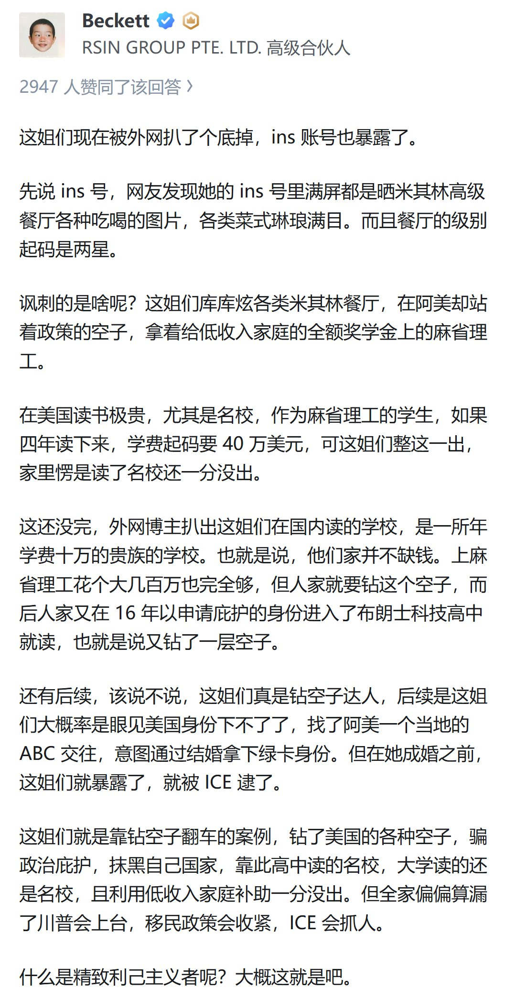

#### 椒龙Josiah

知乎 · 11 月 21 日 · 粉丝 3.5 万 · 赞同 2195 · [原回答](https://www.zhihu.com/question/2107456808227034921/answer/2107816656793768768)

从旅游签证的资产要求推断谢家不缺钱，怀疑家里有金融诈骗，说被抓是自己作的。

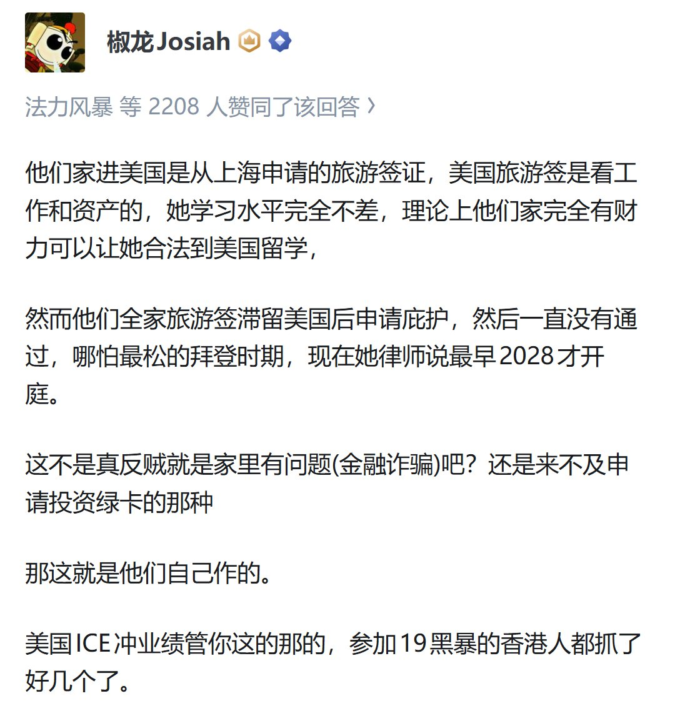

#### Jack

知乎 · 11 月 22 日 · 粉丝 1509 · 赞同 1604 · [原回答](https://www.zhihu.com/question/2107456808227034921/answer/2107861073424654523)

「顿时对 ICE 的好感度 +1」。

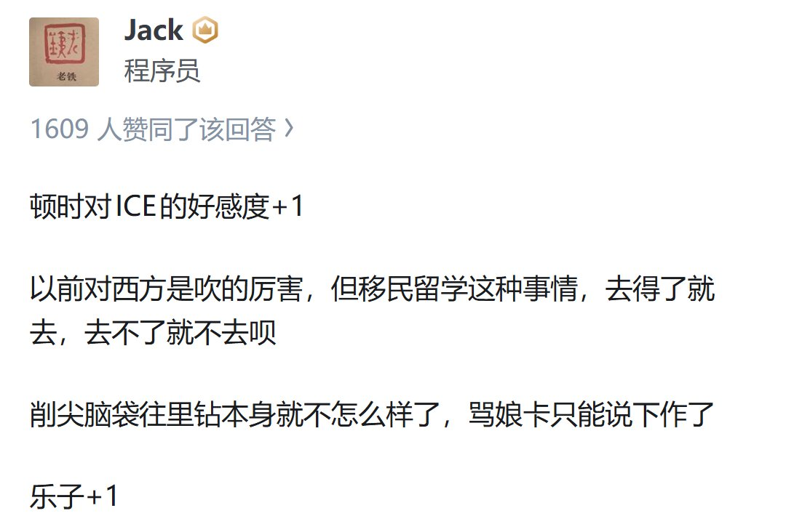

#### Rhodria

知乎 · 11 月 21 日 · 粉丝 5247 · 赞同 1570 · [原回答](https://www.zhihu.com/question/2107456808227034921/answer/2107788572824813731)

说博士生算不上科学家，指她为留在美国不惜污蔑自己的国家。

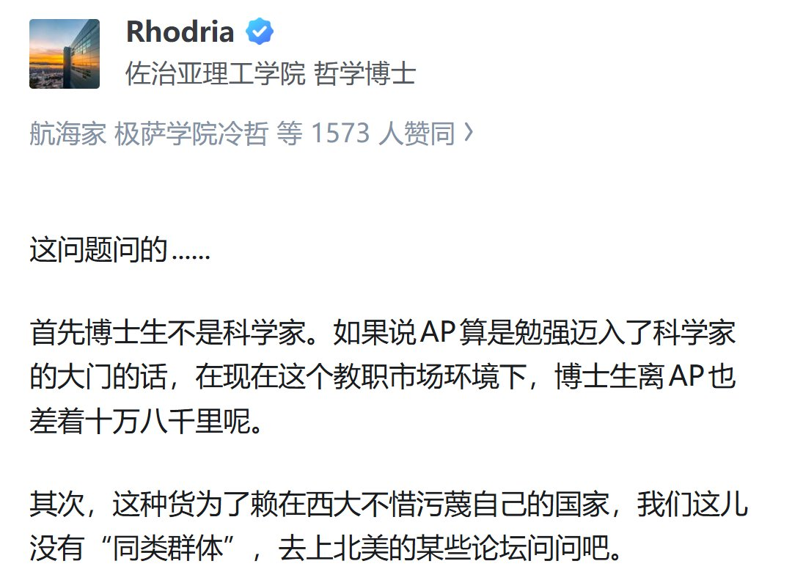

#### 卢振奇

知乎 · 11 月 22 日 · 粉丝 1.6 万 · 赞同 1352 · [原回答](https://www.zhihu.com/question/2107456808227034921/answer/2108045861137785417)

自述家里当年被 P2P 抽干两百万元现金流，要「翻墙去骂几句」。

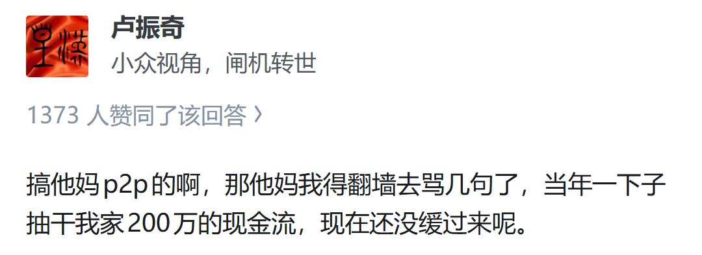

#### Miro

知乎 · 11 月 23 日 · 粉丝 253 · 赞同 888 · [原回答](https://www.zhihu.com/question/2107456808227034921/answer/2108219620620497359)

「祸不及子女的前提是惠不及子女」，认为她知情并受益。

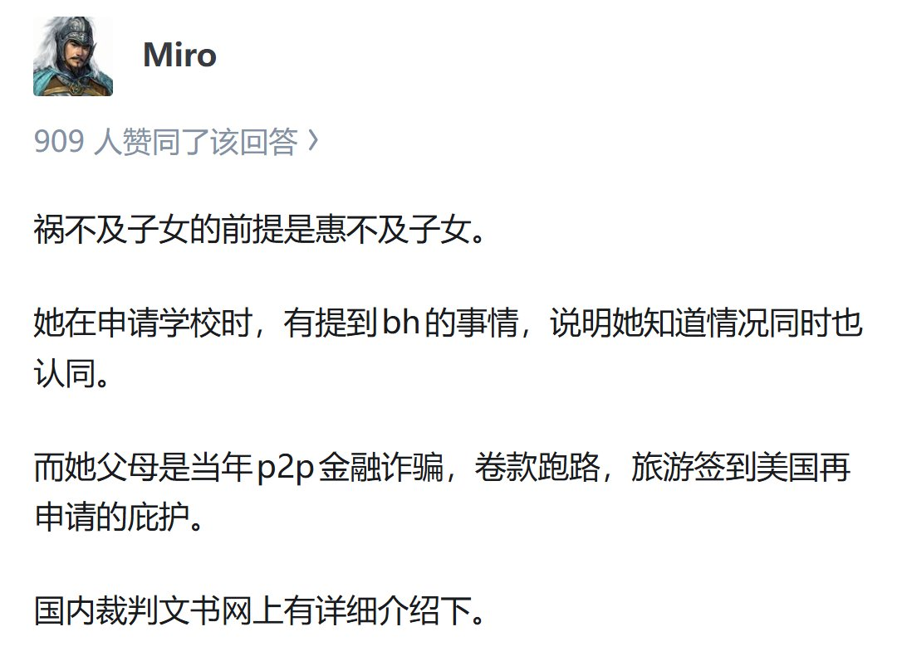

## 不支持拘留

### 海外

#### Mr马总 @WillsonMa1

X · 11 月 22 日 · 粉丝 1 万 · 浏览 18.1 万 · [原帖](https://x.com/WillsonMa1/status/2124736450956562932)

自称认识她父亲十多年，要求公开拘留的法律依据，保障她获得律师帮助和公正程序。

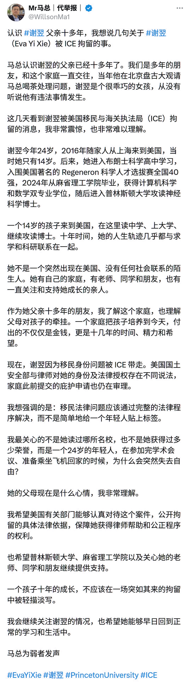

#### 丽莎的云3(今月) @glimmer0324

X · 11 月 23 日 · 粉丝 1989 · 浏览 6.2 万 · [原帖](https://x.com/glimmer0324/status/2124937780258025639)

说已公开的案件是民事借贷纠纷，与 P2P 诈骗无关，ICE 有权抓她但不应该抓。

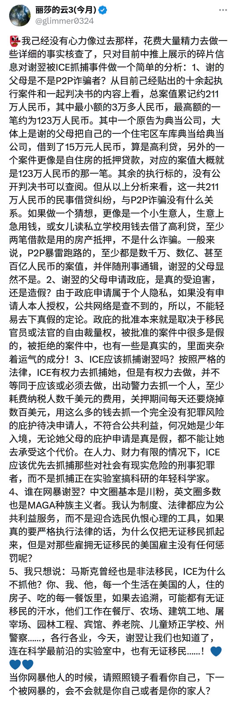

#### 施明磊 @WildKratts722

X · 11 月 22 日 · 粉丝 2654 · 浏览 3.6 万 · [原文](https://x.com/WildKratts722/status/2124610310145180014)

X 长文《逃离中国政府迫害，却困在美国移民监》，写中国在美庇护者的处境。全文约 8100 字，截图只截了标题和第一段。

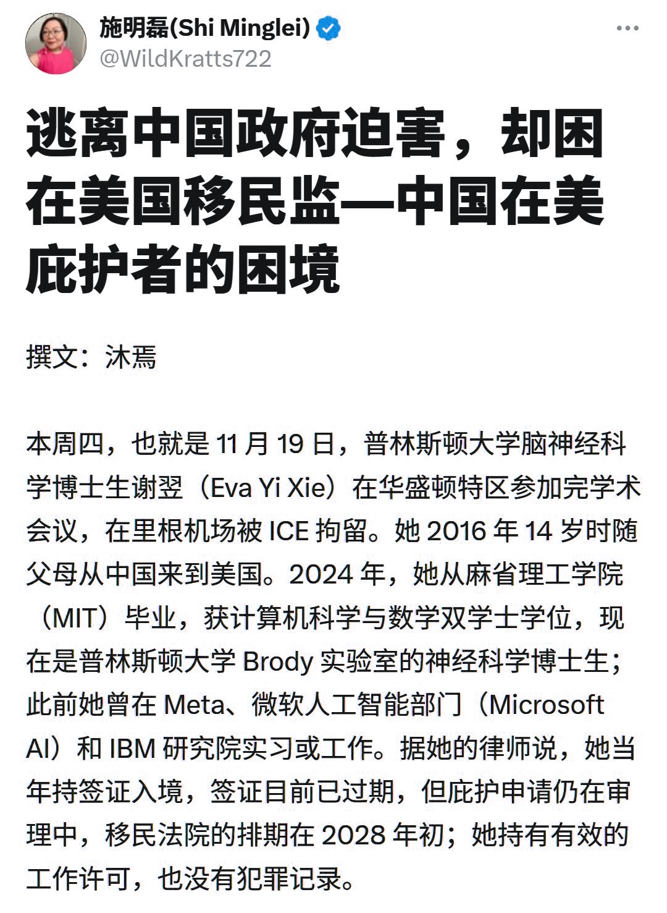

#### 方舟子 @fangshimin

X · 粉丝 93.5 万 · 两帖浏览合计 3.5 万 · [11 月 20 日原帖](https://x.com/fangshimin/status/2123956179898638797) · [11 月 25 日原帖](https://x.com/fangshimin/status/2125697107252420921)

11 月 20 日一帖说她未成年时随父母来美，庇护真假与她无关，问为什么不抓重罪非法移民，偏偏抓名校学生。

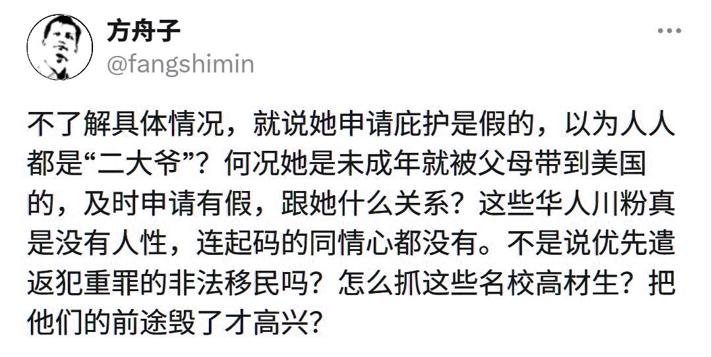

11 月 25 日一帖说她父母在中国的事与她无关，抓她没有人性，落井下石同样没有人性。

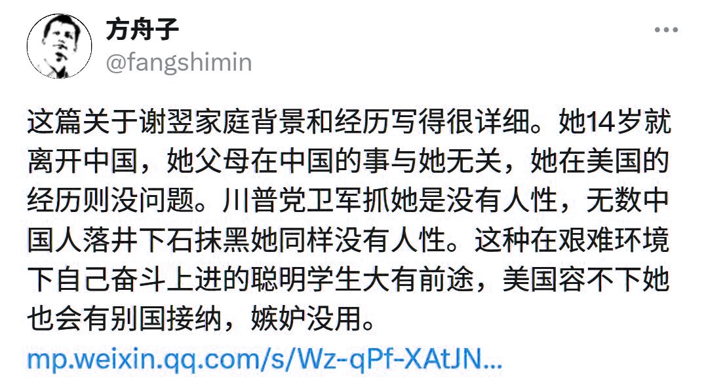

#### JieNAFO @Jienafo

X · 粉丝 7814 · 两帖浏览合计 1.5 万 · [11 月 23 日原帖](https://x.com/Jienafo/status/2124882266111328419) · [11 月 24 日原帖](https://x.com/Jienafo/status/2125436357271044239)

11 月 23 日一帖认为法庭最终会判她赢，批评一些华人慕强，主张未成年随父母来美的人是无辜的。

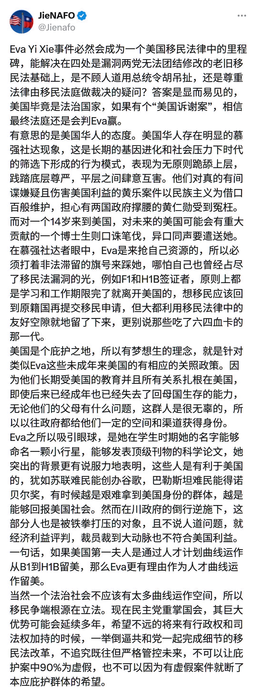

11 月 24 日一帖「再评论一下」，分四点说她父母有民事欠款但没有诈骗，父母的行为不能成为她的原罪，反对 ICE 违法式执法。

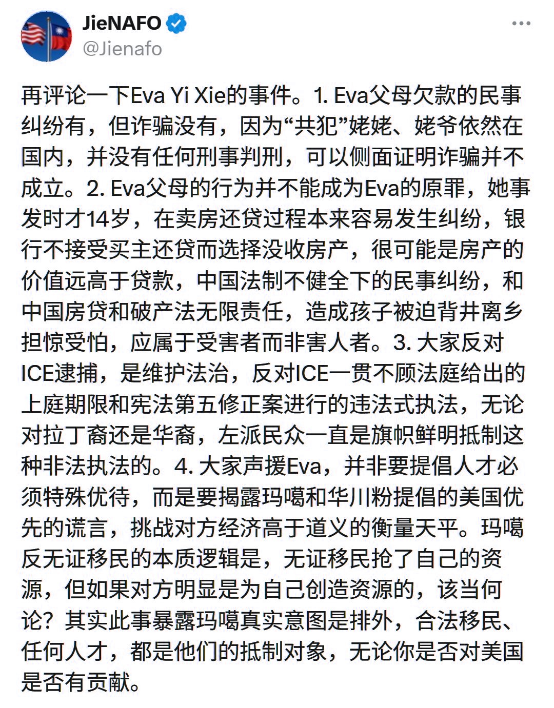

#### Tracy Wen Liu @Tracy_Wen_Liu

X · 11 月 22 日 · 粉丝 2.4 万 · 浏览 9519 · [原帖](https://x.com/Tracy_Wen_Liu/status/2124649050767298584)

追问爆料有什么实际证据，「吃一顿饭 1300 美元是什么原罪吗？」

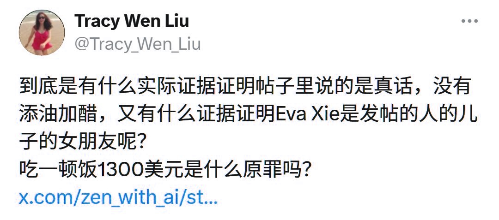

### 国内

没有收录到这一立场的发言。

## 无明显立场

### 海外

#### 蔡子博士Chris @caiziboshi

X · 11 月 22 日 · 粉丝 9.2 万 · 浏览 9.2 万 · [原帖](https://x.com/caiziboshi/status/2124705118532604141)

分别讲庇护与母国联系、助学金与消费、拘留与遣返的区别，承认质疑有合理之处，也反对凭照片认定欺诈。

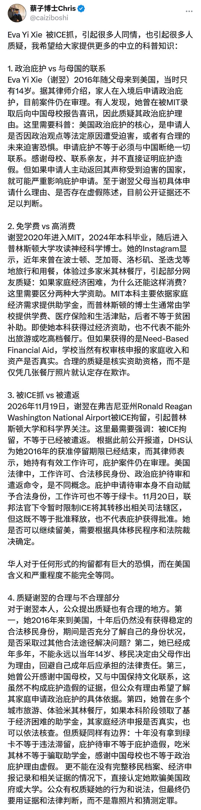

### 国内

#### NormDist

知乎 · 11 月 22 日 · 粉丝 8924 · 赞同 1116 · [原回答](https://www.zhihu.com/question/2107456808227034921/answer/2108015817392758957)

讲庇护待审身份为什么难以转换，说她是被家里坑了。

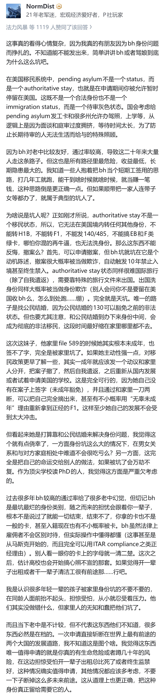
